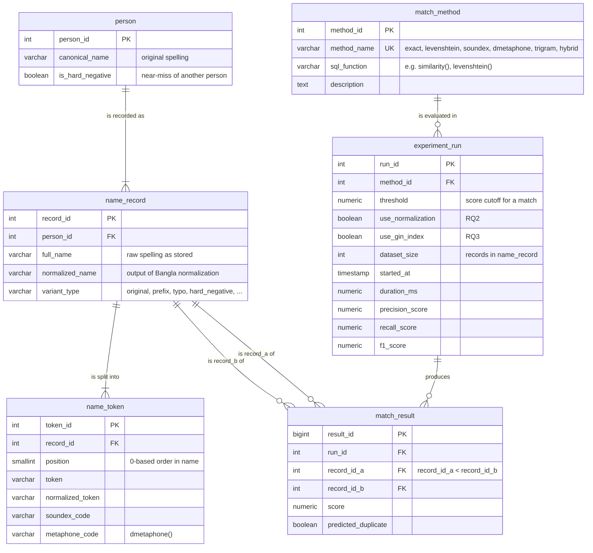

# ER Diagram

## Cardinality

| Relationship | Cardinality | Meaning |
|---|---|---|
| person → name_record | 1 to 1..N | every person has at least the original record |
| name_record → name_token | 1 to 1..N | every name has at least one token |
| match_method → experiment_run | 1 to 0..N | a method may not have been run yet |
| experiment_run → match_result | 1 to 0..N | one row per candidate pair the run scored |
| name_record → match_result | 1 to 0..N (twice) | a record can appear as `record_id_a` or `record_id_b` |

## Notes

- `match_result` has `UNIQUE (run_id, record_id_a, record_id_b)` and `CHECK (record_id_a < record_id_b)`.
- The true label isn't stored. A pair is a real duplicate when both records have the same `person_id`, so it is computed with a join. This keeps precision, recall and F1 in plain SQL.
- `data/gold_pairs.csv` loads into a separate `gold_pair` table used only for evaluation. It isn't part of the core model.
